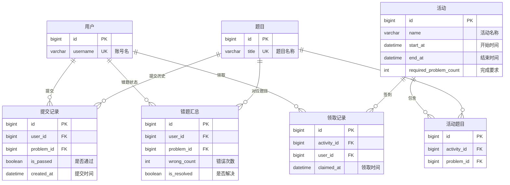

# CodeQuest Python：Oracle 课程演示

面向 Python 初学者的在线练习平台。后端数据库 Oracle，前端使用 React，浏览器中的 Pyodide Web Worker 负责运行 Python 和判题。

业务闭环：**发布题目 → 用户答题 → 保存提交 → 更新错题 → 统计练习 → 完成活动 → 领取签到码**。

## 1. 系统架构与 ORM 的作用

```text
前端页面 → HTTP API → Django 视图 → ORM 生成 SQL → Oracle FREEPDB1 / CODEQUEST
答题页面 → Pyodide Web Worker → 输出与判题结果 → 提交 API
管理员 → Django Admin → ORM → 同一个 Oracle schema
```

- ORM 用 Python 表达查询、关联、聚合和写入，实际仍由 Oracle 执行 SQL。
- 点击“运行代码”仅在浏览器执行 Python，不保存提交；点击“提交代码”才请求后端写库。
- 后端检查提交格式和通过数量的一致性，不重新执行代码；当前全部测试用例会发送到前端。
- 表结构由 Django migrations 创建，SQL 种子脚本只初始化数据。
- 本项目目前没有前台排行榜，活动页面显示的是个人完成进度。

## 2. 核心业务 E-R 图

演讲只展示答题与活动主线的 7 张表，省略分类、测试用例及权限、Session、迁移等辅助信息。
字段只保留主外键和用于讲解的业务状态。`PK` 为主键，`FK` 为外键，`UK` 为唯一字段。



`||` 表示恰好一个，`o{` 表示零到多个。图中中文名称对应实际表：

| 图中名称 | Oracle 表名 |
| --- | --- |
| 用户 | `USERS_USER` |
| 题目 | `PROBLEMS_PROBLEM` |
| 提交记录 | `SUBMISSIONS_SUBMISSION` |
| 错题汇总 | `SUBMISSIONS_WRONGPROBLEM` |
| 活动 | `ACTIVITIES_ACTIVITY` |
| 活动题目 | `ACTIVITIES_ACTIVITYPROBLEM` |
| 领取记录 | `ACTIVITIES_ACTIVITYCHECKIN962A` |

**讲解顺序**：用户对题目可以多次提交 → 失败时更新一条错题汇总 → 活动通过中间表关联题目 → 达标后产生领取记录。

### 关系与完整性

| 关系或约束 | 业务含义 |
| --- | --- |
| 用户与题目通过提交记录关联 | 同一个用户同一道题可以提交多次 |
| 错题表唯一 `(user_id, problem_id)` | 每人每题只保存一条错题汇总 |
| 活动题目表唯一 `(activity_id, problem_id)` | 活动与题目多对多，同一活动不重复选题 |
| 领取表唯一 `(activity_id, user_id)` | 每人每活动只有一条领取记录 |

主键自动生成，外键保证关联对象存在。提交数量一致性和活动起止时间由应用校验，不应把这些 Python 校验当成 Oracle 的 CHECK 约束。

通过 ORM 删除题目会同时删除用例、提交、错题和活动题目关联；删除分类会将题目分类置空。直接执行 SQL 删除时，不能假设 Oracle 外键配置了同样的级联删除行为。

**活动成绩没有独立表，也没有提交到活动的直接外键。** 系统从活动选题、提交时间和通过记录动态计算进度。

## 3. 启动和准备演示数据

### 3.1 连接配置

Oracle 容器名为 `ora-free`，PDB 为 `FREEPDB1`，项目账号为 `CODEQUEST`。
本地根目录 `.env` 配置如下，数据库用户应已创建并具备迁移所需权限：

```dotenv
ORACLE_USER=CODEQUEST
ORACLE_PASSWORD=填写数据库密码
ORACLE_HOST=127.0.0.1
ORACLE_PORT=1521
ORACLE_SERVICE=FREEPDB1
DJANGO_DEBUG=True
```

数据库密码和平台登录密码是两回事。本地 HTTP 开发使用 DEBUG；部署时关闭 DEBUG 并使用 HTTPS。
连接使用 python-oracledb Thin 模式，无需安装 Oracle Client。

在项目根目录执行：

```bash
bun run migrate   # Oracle 创建或更新项目表
bun run csu       # 首次需要管理员时执行
```

### 3.2 首次导入种子数据

本地脚本为 `backend/data/seed_demo.sql`，该目录已被 Git 忽略，换机器时需要单独保存脚本。
脚本要求业务表为空、演示账号无重名，保留已有管理员；不是日常重置命令。

```bash
docker cp backend/data/seed_demo.sql ora-free:/tmp/seed_demo.sql
docker exec -it -e ora-free \
  sqlplus CODEQUEST@//localhost:1521/FREEPDB1
```

在密码提示处输入数据库密码，然后在 SQL*Plus 中运行：

```sql
@/tmp/seed_demo.sql
EXIT;
```

初始化包含 1 个分类、5 道题、10 个用例、25 条提交、4 条错题、1 个活动及 1 条领取记录。
所有普通演示账号的密码为 **`123456789`**：

| 登录用户名 | 初始通过题数 | 状态 |
| --- | ---: | --- |
| `shitongan` | 5 | 已领取签到码，有已解决错题 |
| `xufuxin` | 4 | 已达标，未领取 |
| `wuzhaohua` | 3 | 已达标，未领取 |
| `xiaqianbu` | 3 | 已达标，未领取 |
| `zhangmingyang` | 2 | 未达标，有未解决错题 |
| `lengjiayan` | 1 | 未达标，适合完整演示 |
| `qinshuo` | 0 | 只有失败提交 |
| `liuxiang` | 0 | 只有失败提交 |

题目为两数之和、判断奇偶、求最大值、计算平方、字符串长度；初始代码就是正确代码。
活动“Python 基础练习”要求通过任意 3 道题，时间为初始化时的昨天至 30 天后。

### 3.3 固定基准和启动

确认种子数据符合预期，停止后端后备份一次：

```bash
bun run backup
bun run dev
```

- 前端：<http://localhost:5173>
- Django Admin：<http://localhost:5173/admin/>
- API、后台及媒体请求由 Vite 代理到后端。
- 首次进入答题页需要从 CDN 加载 Pyodide，等待运行环境就绪再提交。

## 4. 现场演示：页面操作 → SQL → 数据效果

建议顺序：**E-R 图 → 登录 → 运行代码 → 提交失败 → 错题本 → 提交通过 → 我的练习统计 → 重复提交 → 活动领取 → 后台报表**。

使用 `lengjiayan` 登录。登录框目前标注“邮箱 / 学号”，实际密码登录按用户名认证，直接输入上述拼音。
以下数字按未修改的种子基准计算；题目 ID 自动生成，不要在演示中写死 ID。

### 4.1 观察初始状态

打开“我的练习”：练习 1 题，通过 1 题，未解决错题 0，按题目统计的通过率为 100%。
已有两条“两数之和”的通过提交，但只计一题。

**讲解**：提交表保存每次历史，统计时按题目去重；提交条数不等于练习题数。

### 4.2 点击“运行代码”

进入“计算平方”，点击“运行代码”，查看输出。
该操作只使用自定义输入调用浏览器中的 Pyodide。

**讲解**：Python 运行、HTTP 请求、数据库写入是三个不同环节。

### 4.3 提交错误代码：INSERT 与 UPDATE

将“计算平方”的代码改为：

```python
print(0)
```

点击“提交代码”，观察后端终端的 `[SQL] 提交代码`。进入“错题本”，该题错误次数为 1、尚未解决。

提交入口：[`create_submission`](backend/apps/submissions/views.py)。代表性 SQL：

```sql
INSERT INTO SUBMISSIONS_SUBMISSION (
    USER_ID, PROBLEM_ID, CODE, IS_PASSED,
    PASSED_COUNT, TOTAL_COUNT, ERROR_MESSAGE, CREATED_AT
)
VALUES (
    :user_id, :problem_id, :code, :is_passed,
    :passed_count, :total_count, :error_message, :created_at
)
RETURNING ID INTO :submission_id;
```

- `INSERT` 保存本次提交，外键指向当前用户和题目。
- `passed_count`、`total_count` 是测试点数，本次为 0 / 2。
- `RETURNING INTO` 将数据库生成的 ID 返回给 Django。
- `CREATED_AT` 后续用于活动时间过滤。

这是该用户第一次在此题失败，ORM 的 `get_or_create()` 查询后创建错题汇总：

```sql
INSERT INTO SUBMISSIONS_WRONGPROBLEM (
    USER_ID, PROBLEM_ID, WRONG_COUNT, LAST_WRONG_AT, IS_RESOLVED
)
VALUES (:user_id, :problem_id, 0, NULL, 0);

UPDATE SUBMISSIONS_WRONGPROBLEM
SET WRONG_COUNT = WRONG_COUNT + 1,
    LAST_WRONG_AT = :now,
    IS_RESOLVED = 0
WHERE ID = :wrong_id;
```

**知识点**：DML、外键、联合唯一约束、算术更新、条件更新、自动生成主键。
再次失败只新增提交并更新原错题，不重复创建错题汇总。当前提交保存与错题更新没有统一事务，不将其讲成事务原子性演示。

### 4.4 改为正确代码：解决错题，保留历史

将代码改为：

```python
n = int(input())
print(n * n)
```

再次点击“提交代码”。仍先新增一条提交，然后执行：

```sql
UPDATE SUBMISSIONS_WRONGPROBLEM
SET IS_RESOLVED = 1
WHERE USER_ID = :user_id
  AND PROBLEM_ID = :problem_id;
```

回到错题本，错误次数仍为 1，但状态已解决；失败和通过提交均保留。
没有旧错题记录时也会执行 UPDATE，只是影响 0 行。

**知识点**：`WHERE` 精确定位、布尔状态更新、历史数据与汇总状态分离。

### 4.5 点击“我的练习”：条件聚合与去重

进入或刷新 `/practice-log`，观察 `[SQL] 我的练习统计`。
聚合入口：[`practice_stats`](backend/apps/submissions/views.py)。对应 ORM：

```python
counts = submissions.aggregate(
    practiced_count=Count("problem_id", distinct=True),
    passed_problem_count=Count("problem_id", filter=Q(is_passed=True), distinct=True),
)
```

简化 SQL：

```sql
SELECT
    COUNT(DISTINCT PROBLEM_ID) AS PRACTICED_COUNT,
    COUNT(DISTINCT CASE
        WHEN IS_PASSED = 1 THEN PROBLEM_ID
    END) AS PASSED_PROBLEM_COUNT
FROM SUBMISSIONS_SUBMISSION
WHERE USER_ID = :user_id;
```

| 表达式 | 含义 |
| --- | --- |
| `WHERE USER_ID = ...` | 只统计当前用户 |
| `COUNT(DISTINCT PROBLEM_ID)` | 每道提交过的题只计一次 |
| `CASE WHEN ... THEN PROBLEM_ID END` | 保留通过题目 ID，其他结果为 NULL |
| `COUNT` 忽略 NULL | 失败记录不增加通过题数 |
| 条件统计内的 `DISTINCT` | 同一题多次通过仍只算一题 |

刚提交失败时，练习 2 题、通过 1 题，通过率 50%；改正确后，练习 2 题、通过 2 题，通过率 100%。
通过率由 Python 用这两个计数相除计算；未解决错题数由另一条查询计算，不包含在打印的聚合语句中。

再正确提交一次“计算平方”，返回“我的练习”：历史多一条，练习和通过仍为 2。

**知识点**：聚合函数、`DISTINCT`、`CASE WHEN`、NULL、列别名、参数化查询。

### 4.6 活动进度和领取：多对多与时间过滤

打开“Python 基础练习”，此时进度为 2 / 3。再通过“判断奇偶”，返回活动页应变为 3 / 3，点击“领取签到码”，显示 `PYTHON2026`。

对应代码：[`activities/services.py`](backend/apps/activities/services.py)。活动完成题数的等价 SQL：

```sql
SELECT COUNT(DISTINCT s.PROBLEM_ID) AS COMPLETED_COUNT
FROM SUBMISSIONS_SUBMISSION s
JOIN ACTIVITIES_ACTIVITYPROBLEM ap ON ap.PROBLEM_ID = s.PROBLEM_ID
JOIN ACTIVITIES_ACTIVITY a ON a.ID = ap.ACTIVITY_ID
WHERE a.ID = :activity_id
  AND s.USER_ID = :user_id
  AND s.IS_PASSED = 1
  AND s.CREATED_AT BETWEEN a.START_AT AND a.END_AT;
```

这里只展示等价统计；列表使用 ORM 子查询，详情查询通过题目 ID 后在 Python 中去重。
活动题目外的提交、时间外提交不计分；重复通过不加分。一次提交可以计入多个题目和时间都匹配的活动。

首次领取会插入 `ACTIVITIES_ACTIVITYCHECKIN962A`，联合唯一约束防止同人同活动出现多条领取记录。
`view_count` 实际是领取接口调用次数，普通 GET 活动详情不会增加它。

**知识点**：多表 JOIN、多对多中间表、时间范围、去重计数、唯一约束。
活动与领取不会打印本次演示日志。领取条件是已登录、活动发布、成绩达标；当前代码不额外判断领取时是否仍在活动时间内。

### 4.7 管理员查看结果

在 Django Admin 的活动列表点击“查看数据”或“导出名单”，查看参与人数、完成人数、领取人数和个人通过题数。
报表由 ORM 按用户聚合生成，CSV 导出读取同一批结果，不会新增业务数据。

**知识点**：分组统计、条件聚合、关联领取记录、查询结果用于报表。

## 5. SQL 日志：哪些操作会触发

本地 `.env` 设置 `DJANGO_DEBUG=True`，在运行 `bun run dev` 的**后端终端**查看，不在浏览器控制台。
打印逻辑直接位于 [`submissions/views.py`](backend/apps/submissions/views.py)，没有独立 SQL 日志辅助文件。

| 操作 | 输出 |
| --- | --- |
| 点击“提交代码” | 提交记录 INSERT |
| 首次提交失败 | 错题 INSERT，以及增加错误次数的 UPDATE |
| 再次失败 | 错题 UPDATE |
| 提交通过 | 将已有错题标为已解决的 UPDATE |
| 进入或刷新“我的练习” | 练习题数与通过题数的聚合 SELECT，每次请求一次 |

题库浏览和筛选、运行代码、错题本、活动和后台报表没有演示 SQL 打印，不代表这些页面都不查询数据库。

日志保留实际 ORM SQL 的参数占位符 `%s`，不输出参数值。上文 SQL 用 `:参数名` 作教学简化；
不能把含 `%s` 的日志原样粘进 SQL*Plus 执行。包装器在执行前打印，所以出现日志也不代表该语句一定执行成功。
关闭 DEBUG 后不打印，ORM 和接口行为保持不变。

## 6. 本次覆盖的 Oracle / SQL 知识点

| 知识点 | 对应演示 |
| --- | --- |
| E-R 建模、一对多、多对多 | 题目用例、提交、活动选题和领取记录 |
| 主键、外键、联合唯一约束 | 自动 ID、用户题目关联、错题与领取记录不重复 |
| INSERT、UPDATE、WHERE | 提交入库、错误次数增加、标记已解决 |
| 聚合、条件表达式、NULL、DISTINCT | 我的练习按不同题目统计 |
| JOIN、时间范围 | 活动内有效提交计数 |
| ORM 与原生 SQL | 页面操作由 ORM 生成 SQL；初始化使用手写 SQL / PL/SQL |
| PL/SQL 局部过程、循环、异常、事务 | 种子脚本的批量初始化、失败回滚、成功 COMMIT |
| schema、用户授权、Data Pump | CODEQUEST 隔离数据，导出和恢复演示基准 |

种子脚本里的过程是匿名 PL/SQL 块内的局部过程，不是数据库中持久保存的存储过程。
当前没有添加自定义视图、触发器或程序包，不把 ORM 功能宣称为这些数据库对象。

## 7. 演示结束：恢复基准备份

停止后端，再在项目根目录执行：

```bash
bun run reset
bun run dev
```

恢复脚本 [`scripts/backup.sh`](scripts/backup.sh) 使用 `ora-free / FREEPDB1`：

1. 读取本地基准 dump，生成 SQLFILE，确认包含 CODEQUEST 表定义。
2. 断开 CODEQUEST 的现有连接，删除并重建用户，密码取自本地 `.env`。
3. 用 Data Pump 导入表、数据、索引、约束等对象。

本地基准备份为 `backend/data/backups/codequest_baseline.dmp`。
恢复会清除基准之后全部 schema 修改，需停止后端避免重新连接。
DDL 检查不能保证后续导入必然成功，若失败应查看容器目录
`/opt/oracle/oradata/codequest_backup/codequest_restore.log`，不要继续往不完整的数据库写数据。

- 恢复后退出原登录会话，再重新登录。
- 活动起止时间按备份原样恢复；长期使用时应检查是否过期，更新基准需另行保留旧备份。
- 上传文件不在 Data Pump 备份中，有二维码图片时另存 `backend/data/media` 或实际配置的媒体目录。

## 8. 维护与检查

管理员录题：创建分类 → 新建题目 → 内联添加测试用例 → 勾选发布。
活动管理：设置时间、完成要求、题目顺序和签到码 → 发布 → 查看数据或导出名单。
新用户通过学校扫码注册，已有演示账号直接用拼音和密码登录。

```bash
# 后端配置检查
cd backend
uv run --env-file ../.env python manage.py check

# 前端检查（另开终端）
cd frontend
bun run lint
bun run build
```

业务验收由演示者完成。运行 Django 测试器时，Oracle 账号还可能需要创建测试用户和表空间的额外权限；
不要将仅通过系统检查或其他数据库上的测试视为 Oracle 业务流程已验收。
